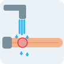
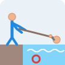

# Emergency First Aid Guide

An offline Android app that tells you what to do in a medical emergency. Type what happened in your own words ("my friend burned his hand", "someone is choking") and the app shows clear, numbered steps, illustrated with things you already have at home: t-shirts, blankets, towels, a chair.

<p>
  
  
  
  
</p>

**[Download the APK](release/first-aid.apk)** (Android 7.0+)

## Features

- **Type, don't search.** A free-text prompt understands word forms (burn / burned / burning), small typos ("choaking", "bleading") and long sentences. If two emergencies are close, it asks you to pick; if nothing matches, it shows the full list.
- **20 emergencies:** choking, severe bleeding, burns, heart attack, stroke, unresponsive / CPR, fainting, seizure, allergic reaction, asthma attack, poisoning, drowning, heatstroke, broken bone or sprain, nosebleed, head injury, electric shock, bites and stings, eye injury, low blood sugar.
- **Everyday items, no medicine.** Steps use what's around you instead of a first aid kit, and never ask you to give medication.
- **Illustrated steps.** 60 hand-built vector illustrations sit beside the instructions.
- **"Do not" list and when to call** for every emergency.
- **One-tap call to 140** (Lebanese Red Cross).
- **Works fully offline.** No internet and no AI: every instruction comes from a fixed, written list, so the app can never make up advice.

## Built with

Kotlin · Jetpack Compose · Material 3 · Android Gradle Plugin 9 · minSdk 24, targetSdk 36

```
app/src/main/java/com/example/firstaid/
├── data/FirstAidData.kt     # emergencies, steps, "do not" lists, keywords
├── logic/Matcher.kt         # offline text matcher (typos, word forms, word order)
├── logic/ExtraKeywords.kt   # extra phrases people actually type
├── ui/Screens.kt            # home, result, choose and no-match screens
├── ui/CallButton.kt         # call 140
└── MainActivity.kt
```

## Run it

Open the folder in Android Studio and press **Run**, or build from the command line:

```
./gradlew assembleDebug
```

## Disclaimer

This app is a quick reference, not a replacement for first aid training or professional medical care. In an emergency, call 140 (Lebanon) or your local emergency number first.

---

Made by [Jad Barakat](https://jadd017.github.io) · [LinkedIn](https://www.linkedin.com/in/jad-barakat-858951240)
